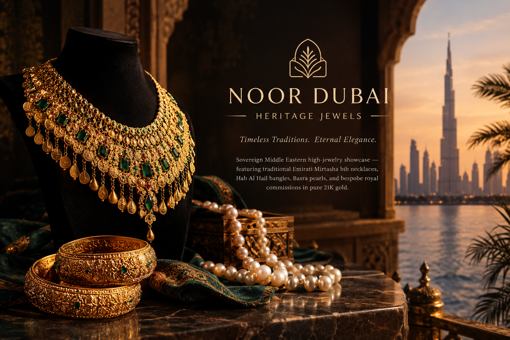

<p align="center">
  
</p>

<h1 align="center">Noor Dubai Heritage Jewels</h1>

<p align="center">
  <em>Timeless Traditions. Eternal Elegance.</em>
</p>

**Sovereign Middle Eastern High Jewelry**

A luxury jewellery showcase inspired by Emirati heritage, traditional Gulf adornment, and the timeless elegance of Middle Eastern high jewelry.

[**Live Demo**](https://noor-dubai-heritage-jewels.vercel.app/) · [**GitHub Repository**](https://github.com/MahamYasir-ai/noor-dubai-heritage-jewels)

---

## Overview

Noor Dubai Heritage Jewels presents an elevated digital experience inspired by the artistry, symbolism, and cultural legacy of traditional Middle Eastern jewellery.

The concept brings together elaborate Emirati Mirtasha bib necklaces, Hab Al Hail bangles, luminous Basra pearls, and bespoke royal commissions in a refined luxury setting. Its visual identity celebrates the richness of Gulf heritage while presenting traditional jewellery through a contemporary digital storefront.

## Highlights

- **Emirati Heritage** — Inspired by traditional Gulf jewellery, ceremonial adornment, and regional craftsmanship.
- **Mirtasha Necklaces** — Showcasing the grandeur of traditional bib-style jewellery.
- **Hab Al Hail Bangles** — Highlighting distinctive traditional bangle designs.
- **Basra Pearls** — Celebrating the elegance and historical significance of regional pearl traditions.
- **Bespoke Commissions** — A concept for exclusive, individually envisioned statement pieces.
- **Luxury Visual Experience** — A premium presentation designed around heritage, detail, and sophistication.
- **Responsive Design** — Intended to provide a polished browsing experience across desktop and mobile devices.

*The features and collections described above reflect the project's design concept. Interactive functionality depends on the implementation in the live application.*

## Live Preview

Explore the deployed website:

**[noor-dubai-heritage-jewels.vercel.app](https://noor-dubai-heritage-jewels.vercel.app/)**

<!-- Add screenshots here after uploading them to assets/screenshots/ -->

## Technology Stack

The technologies used in this project can be confirmed from the repository's source files and `package.json`.

- Frontend: To be confirmed from the project configuration
- Styling: To be confirmed from the project configuration
- Deployment: Vercel

## Getting Started

To run the project locally, first clone the repository:

```bash
git clone https://github.com/MahamYasir-ai/noor-dubai-heritage-jewels.git
cd noor-dubai-heritage-jewels
```

Install dependencies:

```bash
npm install
```

Start the development server:

```bash
npm run dev
```

Open the local URL displayed in your terminal.

**Requirements:** Node.js and npm, assuming the repository uses a Node.js-based frontend framework.

## Project Purpose

Noor Dubai Heritage Jewels is a web development portfolio project exploring how cultural heritage, luxury brand positioning, and contemporary interface design can come together in a premium jewellery experience.

The project demonstrates an approach to creating a distinctive digital brand identity inspired by traditional craftsmanship and the heritage of the Gulf region.

## Author

**Maham Yasir**

Electronics Engineer | AI & Technology Projects

- GitHub: [@MahamYasir-ai](https://github.com/MahamYasir-ai)

---

*Inspired by the enduring artistry and heritage of Middle Eastern high jewelry.*
