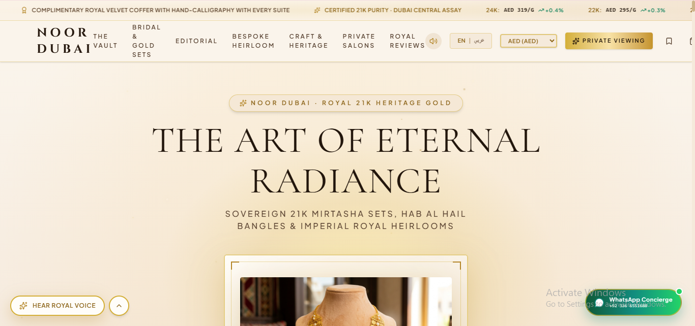
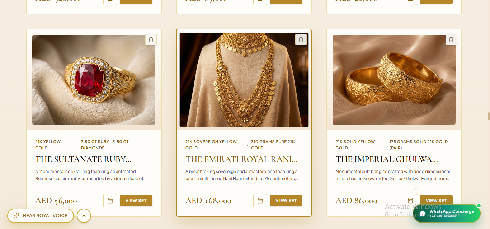
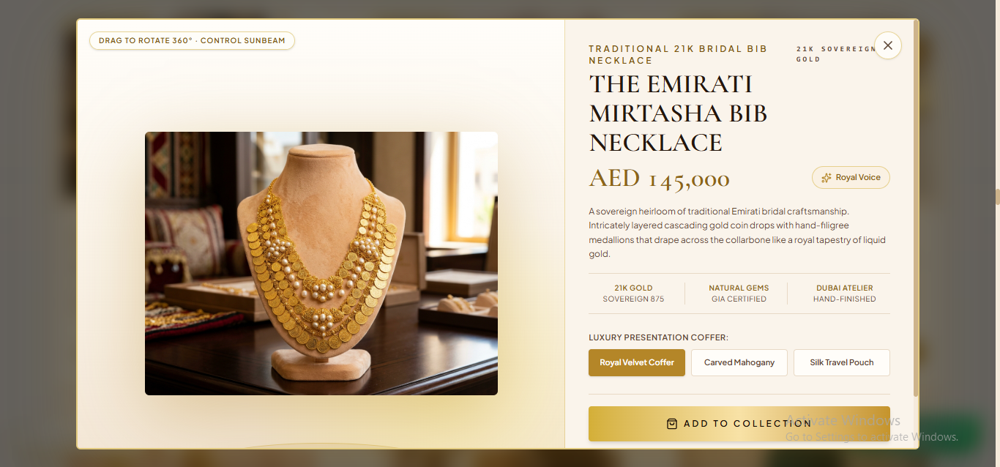
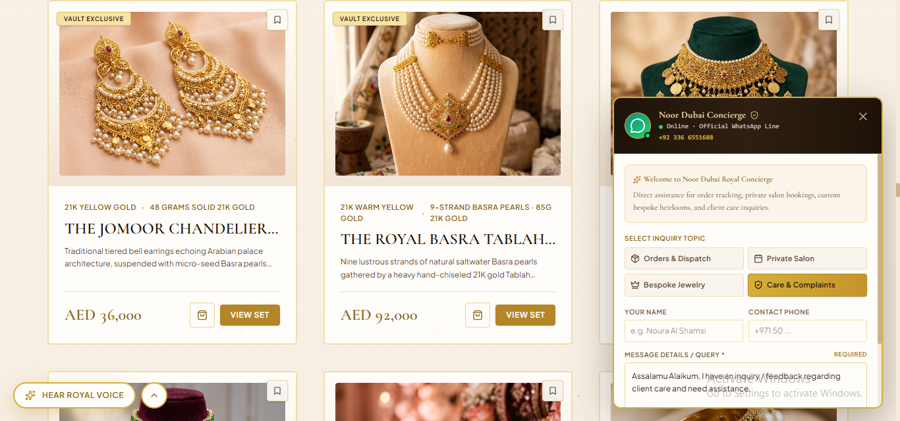
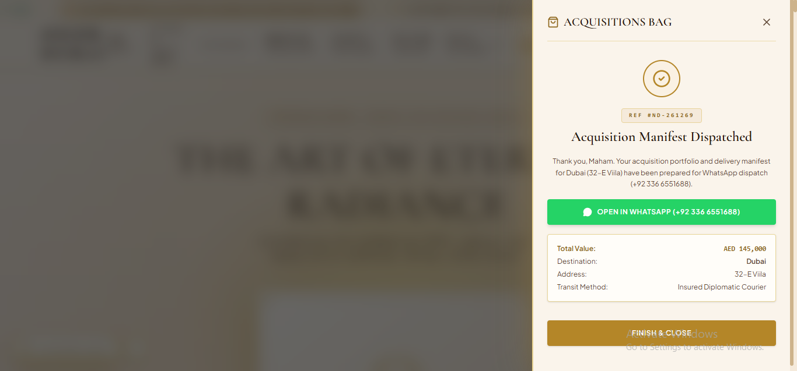
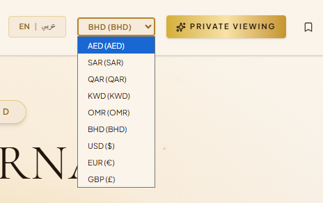
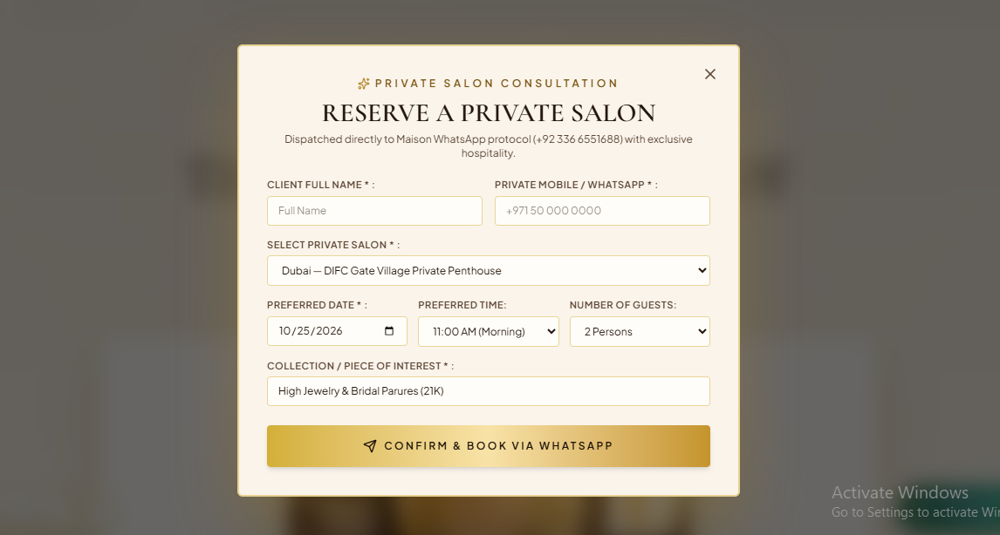

# Noor Dubai Heritage Jewels

<p align="center">
  
</p>

<h3 align="center">Sovereign Middle Eastern High Jewelry</h3>

<p align="center">
  A digital luxury jewellery experience inspired by Emirati heritage, royal elegance, and traditional Gulf craftsmanship.
</p>

<p align="center">
  <a href="https://noor-dubai-heritage-jewels.vercel.app/">Live Demo</a> ·
  <a href="https://github.com/MahamYasir-ai/noor-dubai-heritage-jewels">Source Code</a>
</p>

---

## Overview

Noor Dubai Heritage Jewels is a luxury jewellery storefront concept inspired by the rich heritage of Middle Eastern high jewelry. It combines traditional Emirati jewellery aesthetics with a contemporary online shopping experience, customer-support automation, WhatsApp integration, and regional currency conversion.

The concept showcases traditional Mirtasha bib necklaces, Hab Al Hail bangles, Basra pearls, and bespoke royal commissions in a premium digital setting.

Designed around the expectations of a luxury audience, the experience brings together product discovery, shopping interactions, personalized customer assistance, and exclusive private jewellery viewing.

## Live Demo

**Explore the website:** [noor-dubai-heritage-jewels.vercel.app](https://noor-dubai-heritage-jewels.vercel.app/)

## Screenshots

### 1. Homepage and Luxury Brand Identity



The visual identity introduces the brand's Middle Eastern heritage and premium jewellery positioning.

### 2. Jewellery Collections



Explore the jewellery collections and product presentation inspired by traditional Gulf craftsmanship.

### 3. Product Details and Shopping Cart



Product browsing and cart interactions support the digital shopping journey.

### 4. WhatsApp Customer-Support Assistant



A WhatsApp-based helpline assistant helps customers with jewellery enquiries, delivery questions, and customization-related queries.

### 5. WhatsApp Order and Dispatch Updates



WhatsApp integration supports order-related communication, including order confirmations and dispatch updates where implemented.

### 6. Multi-Currency Pricing



Regional currency options for customers across the Gulf, including:

- AED — United Arab Emirates dirham
- QAR — Qatari riyal
- SAR — Saudi riyal

### 7. Private Jewellery Viewing



An exclusive viewing concept for clients interested in exploring heritage collections and exceptional jewellery pieces through a personalized experience.

## Key Features

- **Luxury Jewellery Storefront** — A premium digital presentation inspired by Middle Eastern high jewelry.
- **Heritage Collections** — Showcases jewellery concepts influenced by Emirati and Gulf traditions.
- **Product Browsing and Cart** — Supports product discovery and shopping-cart interactions.
- **WhatsApp Customer Support** — An assistant for delivery, customization, and product-related questions.
- **WhatsApp Order Communication** — Supports customer messaging around order placement and dispatch, depending on the configured workflow.
- **Multi-Currency Pricing** — Supports AED, QAR, and SAR display or conversion.
- **Private Jewellery Viewing** — Presents an exclusive viewing experience for high-value and bespoke pieces.
- **Responsive Digital Experience** — Designed for browsing across different screen sizes.

## Technology Stack

- **Deployment:** Vercel
- **Frontend and styling:** Refer to the repository source files and package configuration for the exact frameworks and libraries.
- **Messaging integration:** WhatsApp, according to the configured implementation
- **Currency handling:** AED, QAR, and SAR conversion or display

## Run Locally

Clone the repository:

```bash
git clone https://github.com/MahamYasir-ai/noor-dubai-heritage-jewels.git
cd noor-dubai-heritage-jewels
```

If the project uses a Node.js-based frontend, install its dependencies:

```bash
npm install
```

Start the development server using the script defined in `package.json`, commonly:

```bash
npm run dev
```

Follow the terminal output to open the local application.

## Project Goals

This project explores how luxury brand storytelling, cultural heritage, e-commerce interactions, customer-support automation, and regional shopping considerations can come together in a distinctive digital experience.

It also demonstrates the potential of integrating messaging workflows and multi-currency support into a niche luxury storefront.

## Author

**Maham Yasir**

GitHub: [@MahamYasir-ai](https://github.com/MahamYasir-ai)

---

<p align="center">
  <em>Timeless Traditions. Eternal Elegance.</em>
</p>
